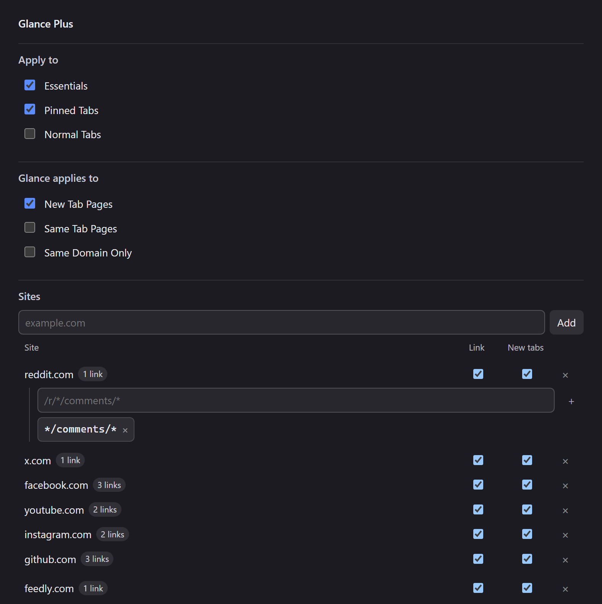

<p align="center">
  
</p>

<h1 align="center">Glance Plus</h1>

<p align="center">
  <strong>Zen's Glance, without the gesture.</strong><br>
  A new tab opens over the page you are reading instead of replacing it, and each site decides which of its pages are worth one.
</p>

<p align="center">
  <a href="https://github.com/apoapostolov/Zen-Glance-Plus/releases/latest"></a>
  <a href="LICENSE"></a>
  <a href="https://github.com/zen-browser/desktop"></a>
  
</p>

<p align="center">
  
</p>

## What it changes

Zen's Glance shows a page over the tab you are on. Stock Zen only raises it for a gesture: a modifier click on a link, a bookmark or search result with the modifier held, or a link that leaves an essential tab. Glance Plus makes the Glance the ordinary way a page opens, decided by the kind of tab it came from and, per site, by the kind of page it is.

Both ways a page can open count: a tab the browser creates, and a link inside a page that opens a tab of its own. A post clicked inside its own site's essential is the second kind, and it glances too.

## Install

1. In Zen settings, open Sine and add a mod from the repository `apoapostolov/Zen-Glance-Plus`.
2. Check that `sine.allow-unsafe-js` is `true` in `about:config`. A repository install is not a store install, so Sine refuses to run its script without that preference, and the mod then shows as enabled while doing nothing.
3. Restart Zen. Chrome scripts load at startup.

## Settings

Six switches decide every site that has no row of its own, under two headings.

| Setting | Default | Effect |
| --- | --- | --- |
| Essentials | On | A new tab opened from an essential becomes a Glance |
| Pinned Tabs | On | The same for a pinned tab |
| Normal Tabs | Off | The same for an ordinary tab |
| New Tab Pages | On | The same for a New Tab page |
| Same Tab Pages | Off | A page-initiated open that would replace the ordinary tab you are on becomes a Glance instead |
| Same Domain Only | Off | A page glances only when it belongs to the domain it was opened from |

`Same Domain Only` compares the domains themselves, not the hosts, so `old.reddit.com` opening from `reddit.com` still counts as the same place and `github.com` opening from a Reddit tab does not. It holds for a site row as well: with the switch on, no row can glance a page outside its own domain. A New Tab page has no domain to stay in, so nothing opened from one is constrained.

A tab is classified once: essentials first, because they are pinned as well, then pinned tabs, then New Tab pages, which are ordinary tabs carrying Zen's own marker, then ordinary tabs.

### Sites

Add a domain, and its row has two switches: **Link** for clicks that would replace the page you are on, and **New tabs** for links that open a tab. A row answers for its domain and every subdomain, so `reddit.com` covers `old.reddit.com`, and it overrides the five switches in both directions: with **New tabs** off, that site never glances a new tab, even from an essential.

Changes save as you make them and apply to the next page you open.

The table starts populated: reddit.com, x.com, facebook.com, youtube.com, instagram.com, github.com and feedly.com, each row narrowed to that site's content pages — a post, a status, a video, an issue, a comment thread, an article in Feedly's own reader — so a fresh install glances something before you touch a setting. Those rows are written once, on the first start after install. Delete one and it stays deleted; the defaults never come back.

### Link patterns

Click a site name and the row opens its patterns. With none, every link on the site glances. With patterns, only matching links do, which is how a subreddit's posts open in Glance while its listings, front page and settings stay ordinary tabs:

```
/r/*/comments/*      a post from a subreddit listing
*/comments/*         a post opened from a profile or the front page
/i/entry/*           an article opened in Feedly's reader
```

Patterns match the address path and query, never the domain, because the row already supplies the domain. `*` stands for anything, including `/`. A pattern beginning with `/` is anchored at the path root; one beginning with `*` matches anywhere; one typed without either is read as `*pattern`. A pasted address keeps only its path. Matching is case-sensitive.

## Behaviour worth knowing

- Zen holds one Glance at a time. When a second page matches while one is open, the open one is turned into a real tab and the new page is shown as a Glance.
- A page that would have opened in a background tab opens as a Glance instead, which brings it on screen.
- A link that opens a tab from inside a page — `target="_blank"`, a middle click, `window.open` — is judged on the address it will load, not the empty tab that carries it. That is what makes a post clicked inside its own site's essential open as a Glance, which Zen's own rule refuses because the domains match.
- One thing is out of reach: a plain left click that navigates the tab you are already on creates no tab at all, so there is nothing to divert. `Apply to Normal Tab Redirection` and a row's **Link** switch cover the page-initiated opens that do reach the browser window, such as a context menu's "open link in this tab". Nothing typed in the address bar is affected.
- Essential and pinned tab creation, "open all in tabs", session restore and unloaded opens are left alone.
- Zen's own Glance switch wins. With Glance turned off in `Settings > Look and Feel`, this mod does nothing.
- Nothing is converted while Zen runs a Glance animation.

## How it works

Two seams, because a page can open a tab in two ways that look different from the browser window.

The first is `gBrowser.addTab`, which every tab the browser creates passes through and which carries the address. The mod records a plan there and converts the new tab on the `TabOpen` event that `addTab` dispatches, handing the opened tab to `gZenGlanceManager.openGlance()` as an existing tab so no second tab is created and no second load starts. `addTab` rather than `TabOpen` alone, because `TabOpen` fires before the browser begins loading, when the tab still holds `about:blank` and there is no address to test.

The second is `gZenGlanceManager.shouldOpenTabInGlance`, Zen's own check. A tab opened by a link inside a page reaches `addTab` empty and loads itself afterwards, so the browser window never sees its address; Zen keeps that address and passes it to its own check along with the tab it created. The mod answers there too, with the same switches and site patterns, and leaves Zen's answer alone when Zen's answer is yes. `docs/glance-internals.md` documents the browser code both rest on, with file and line references from Zen Twilight 1.24t.

## When something does not work

The mod writes `<profile>/zen-glance-plus.log` as it runs: one line when it loads, one when it starts with its hook state and site count, one per tab it decides about, and one for how the settings table was placed. It is the fastest way to tell "the script never ran" from "the script ran and declined", and it costs a few kilobytes at most.

## Testing

```
node tests/zen-glance-plus.test.mjs scripts/zen-glance-plus.uc.js
node tests/sites.test.mjs scripts/zen-glance-plus.uc.js
```

Both harnesses run the shipped script in a Node VM. The first drives stubbed browser globals: every tab kind and its switch, the conversion, the single-Glance conflict, the redirect seam, a site row and its patterns overriding a switch, and the restore path. The second supplies a small DOM and covers the site list from storage to the rendered table and back, including the pattern editor and the three ways the table can find its place in the settings page. `ONLY="New Tab" node tests/zen-glance-plus.test.mjs` runs a subset of either suite.

## Licence

MIT. `CREDITS.md` records what the idea owes to other work.
