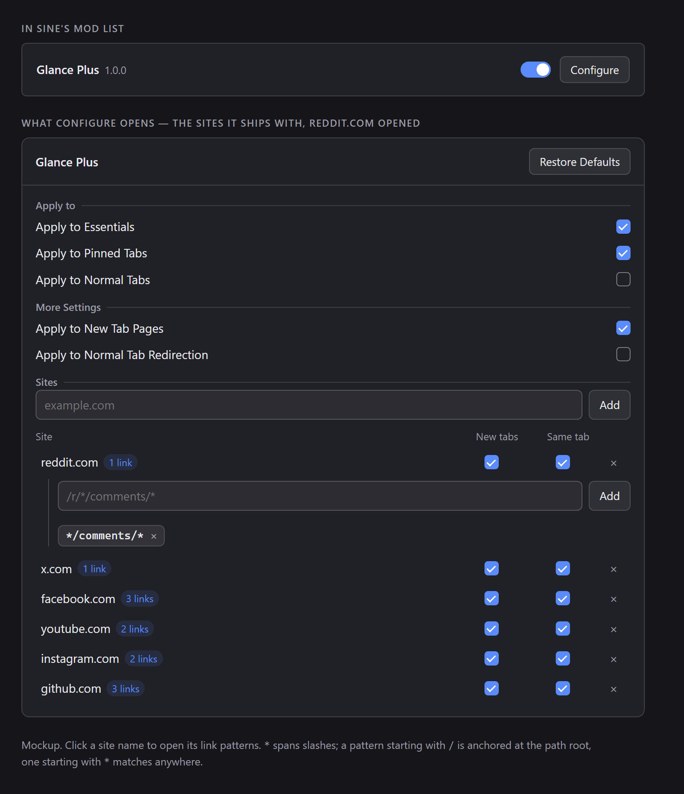

<p align="center">
  
</p>

<h1 align="center">Glance Plus</h1>

<p align="center">
  <strong>Zen's Glance, without the gesture.</strong><br>
  A new tab opens over the page you are reading instead of replacing it, and each site decides which of its pages are worth one.
</p>

<p align="center">
  <a href="https://github.com/apoapostolov/Zen-Glance-Plus/releases/latest"></a>
  <a href="LICENSE"></a>
  <a href="https://github.com/zen-browser/desktop"></a>
  
</p>

<p align="center">
  
</p>

## What it changes

Zen's Glance shows a page over the tab you are on. Stock Zen only raises it for a gesture: a modifier click on a link, a bookmark or search result with the modifier held, or a link that leaves an essential tab. Glance Plus makes the Glance the ordinary way a page opens, decided by the kind of tab it came from and, per site, by the kind of page it is.

## Install

1. In Zen settings, open Sine and add a mod from the repository `apoapostolov/Zen-Glance-Plus`.
2. Check that `sine.allow-unsafe-js` is `true` in `about:config`. A repository install is not a store install, so Sine refuses to run its script without that preference, and the mod then shows as enabled while doing nothing.
3. Restart Zen. Chrome scripts load at startup.

## Settings

Five switches decide every site that has no row of its own.

| Setting | Default | Effect |
| --- | --- | --- |
| Apply to Essentials | On | A new tab opened from an essential becomes a Glance |
| Apply to Pinned Tabs | On | The same for a pinned tab |
| Apply to Normal Tabs | Off | The same for an ordinary tab |
| Apply to New Tab Pages | On | The same for a New Tab page |
| Apply to Normal Tab Redirection | Off | A page-initiated open that would replace the ordinary tab you are on becomes a Glance instead |

A tab is classified once: essentials first, because they are pinned as well, then pinned tabs, then New Tab pages, which are ordinary tabs carrying Zen's own marker, then ordinary tabs.

### Sites

Add a domain, and its row has a switch for the site's new tabs and a switch for links that would replace the current tab. A row answers for its domain and every subdomain, so `reddit.com` covers `old.reddit.com`, and it overrides the five switches in both directions: with **New tabs** off, that site never glances a new tab, even from an essential.

Changes save as you make them and apply to the next page you open.

The table starts populated: reddit.com, x.com, facebook.com, youtube.com, instagram.com and github.com, each row narrowed to that site's content pages — a post, a status, a video, an issue, a comment thread — so a fresh install glances something before you touch a setting. Those rows are written once, on the first start after install. Delete one and it stays deleted; the defaults never come back.

### Link patterns

Click a site name and the row opens its patterns. With none, every link on the site glances. With patterns, only matching links do, which is how a subreddit's posts open in Glance while its listings, front page and settings stay ordinary tabs:

```
/r/*/comments/*      a post from a subreddit listing
*/comments/*         a post opened from a profile or the front page
```

Patterns match the address path and query, never the domain, because the row already supplies the domain. `*` stands for anything, including `/`. A pattern beginning with `/` is anchored at the path root; one beginning with `*` matches anywhere; one typed without either is read as `*pattern`. A pasted address keeps only its path. Matching is case-sensitive.

## Behaviour worth knowing

- Zen holds one Glance at a time. When a second page matches while one is open, the open one is turned into a real tab and the new page is shown as a Glance.
- A page that would have opened in a background tab opens as a Glance instead, which brings it on screen.
- `Apply to Normal Tab Redirection` and a row's **Same tab** switch cover page-initiated opens that reach the browser window, such as a context menu's "open in this tab". A plain left click inside a page is performed by the content process and never reaches the browser window, so no mod of this shape can divert it. Nothing typed in the address bar is affected.
- Essential and pinned tab creation, "open all in tabs", session restore and unloaded opens are left alone.
- Zen's own Glance switch wins. With Glance turned off in `Settings > Look and Feel`, this mod does nothing.
- Nothing is converted while Zen runs a Glance animation.

## How it works

The script wraps `gBrowser.addTab`, the one function every tab-opening path in the browser window reaches, and which carries the address. It records a plan there, then converts the new tab on the `TabOpen` event that `addTab` dispatches, passing the opened tab to `gZenGlanceManager.openGlance()` as an existing tab so no second tab is created and no second load starts.

`addTab` is the seam rather than `TabOpen` alone because `TabOpen` fires before the browser begins loading, at which point the tab still holds `about:blank` and there is no address to test. `docs/glance-internals.md` documents the browser code this rests on, with file and line references from Zen Twilight 1.24t.

## Testing

```
node tests/zen-glance-plus.test.mjs scripts/zen-glance-plus.uc.js
node tests/sites.test.mjs scripts/zen-glance-plus.uc.js
```

Both harnesses run the shipped script in a Node VM. The first drives stubbed browser globals: every tab kind and its switch, the conversion, the single-Glance conflict, the redirect seam, a site row and its patterns overriding a switch, and the restore path. The second supplies a small DOM and covers the site list from storage to the rendered table and back, including the pattern editor. `ONLY="New Tab" node tests/zen-glance-plus.test.mjs` runs a subset of either suite.

## Licence

MIT. `CREDITS.md` records what the idea owes to other work.
